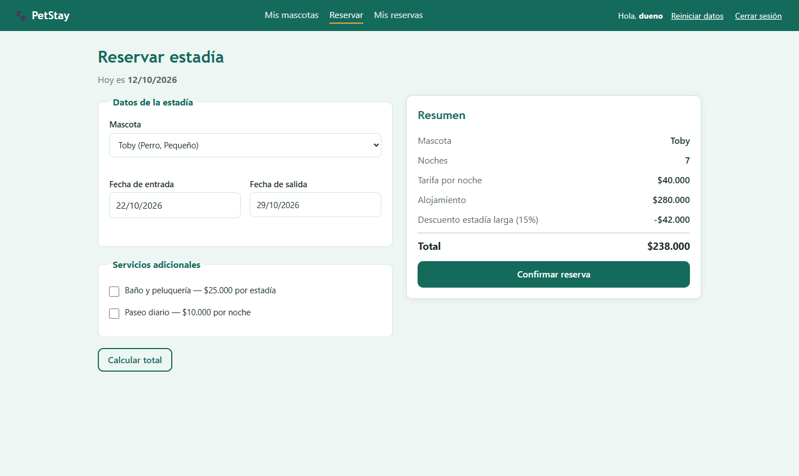
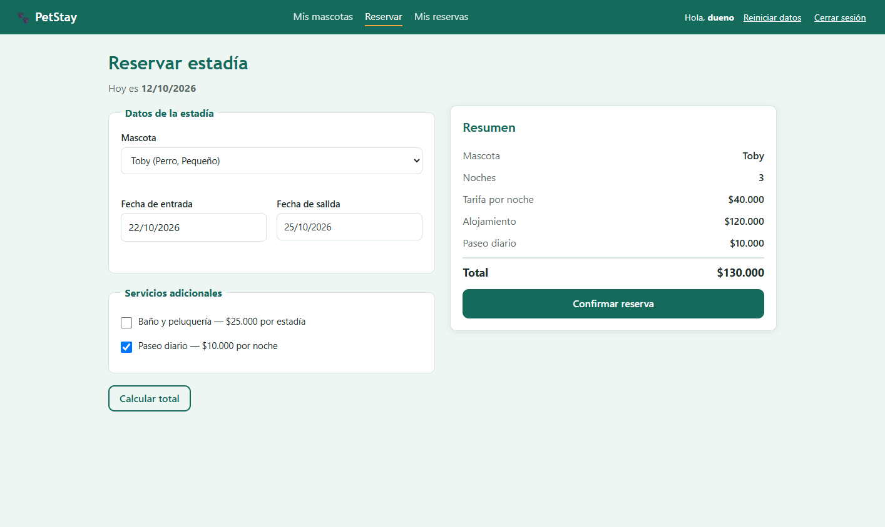

# Resultado de la ejecución local

Ejecución completa contra **https://petstay-aphn.onrender.com**, iniciada el **12 de octubre de 2026 a las 22:08 (America/Bogota)**. Entorno: Windows, Chrome, JDK 21.0.7, Serenity 4.2.32 y Gradle 8.14.3.

Comando: `gradlew.bat clean test aggregate --console=plain`.

| Medida | Resultado |
|---|---:|
| Casos Gherkin distintos | 29 |
| Ejecuciones contando ejemplos | 46 |
| Ejecuciones exitosas | 44 |
| Fallos funcionales | 2 |
| Errores de infraestructura | 0 |
| Ejecuciones omitidas | 0 |
| Casos completos exitosos en Serenity | 27 |
| Casos con fallo en Serenity | 2 |

La ejecución de pruebas duró aproximadamente siete minutos. Gradle terminó con código distinto de cero por los dos defectos detectados; tanto JUnit como el reporte Serenity coinciden. `verifySerenityResults` también detectó ambos fallos. No se deshabilitaron los casos fallidos.

## Defectos reproducidos

| Caso | Regla | Esperado | Observado |
|---|---|---|---|
| TC14 | Descuento solo para más de siete noches | Siete noches, descuento $0, total $280.000 | Descuento $42.000, total $238.000 |
| TC15 | Paseo de $10.000 por noche | Tres noches, paseos $30.000, total $150.000 | Paseos $10.000, total $130.000 |

Detalles de reproducción y propuesta de corrección: [DEFECTOS.md](DEFECTOS.md).

### Evidencia TC14

### Evidencia TC15

## Archivos de evidencia

- [Resumen estructurado de la ejecución](evidencias/resultado-ejecucion.json): identifica los 29 casos y su resultado.
- [Resultados originales de JUnit](evidencias/junit.xml): 46 ejecuciones, dos fallos y ninguna omitida.
- Reporte completo con navegación y capturas: `target/site/serenity/index.html`.
- Los archivos JSON originales de Serenity y las capturas de todos los pasos se conservan junto al reporte completo.

Este resultado corresponde a la aplicación publicada en la fecha de ejecución. Una nueva ejecución depende del estado de PetStay y de cualquier cambio que realice su responsable. No se ha ejecutado todavía el workflow en GitHub Actions ni se han creado los issues remotos.
